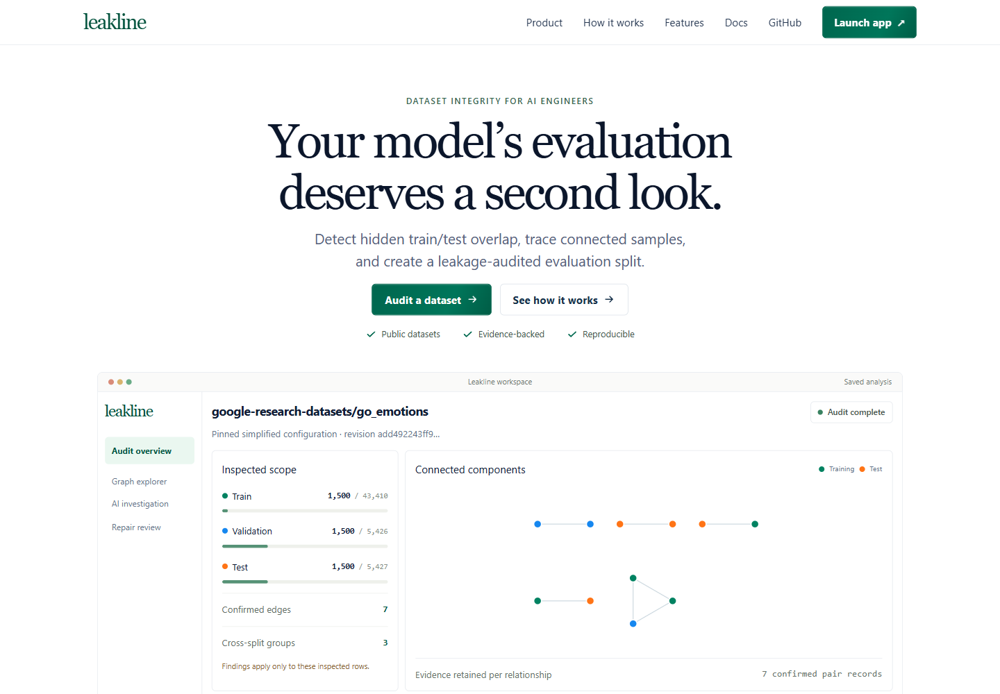

# Leakline

**Your AI benchmark may be lying.** Leakline uses FalkorDB to find connected train/evaluation examples, show the evidence path, propose a bounded repair, and independently verify the result.

**Graph Hacks · Track 01: Agents That Act on Connected Data**
FalkorDB is the decision layer: confirmed duplicate edges form graph components, and those components determine which repair actions are safe. The agent reads that evidence through bounded MCP tools; it cannot invent graph facts or approve its own proposal.



> **Demo video:** not published yet. A working demo video is required for the submission; see the [submission checklist](docs/track-01-compliance.md). No placeholder or unverified video link is shown here.

## Try it locally

Leakline is a local-first app. It needs Docker Desktop, Python 3.13 with `uv`, Node.js 20.9 or newer, and npm. No API key is needed for dataset inspection, graph analysis, repair planning, or verification. AI investigation additionally needs an OpenRouter key.

From the repository root, start FalkorDB and install the API environment:

```powershell
docker compose up -d
uv sync --locked
uv run python scripts/check_falkordb_capabilities.py
```

In the first terminal, start the API:

```powershell
uv run uvicorn leakline.main:app --app-dir apps/api --host 127.0.0.1 --port 8000
```

In a second terminal, start the web app:

```powershell
npm ci
npm run dev
```

Open [http://localhost:3000](http://localhost:3000), then choose **Launch app** → **Inspect a dataset**. The API docs are at [http://127.0.0.1:8000/docs](http://127.0.0.1:8000/docs). FalkorDB Browser runs at [http://localhost:3001](http://localhost:3001).

For AI investigation, copy `.env.example` to `.env` and set `OPENROUTER_API_KEY`. Python does not load `.env` automatically; start the API from `apps/api` with `uv run --env-file ../../.env uvicorn leakline.main:app --app-dir . --host 127.0.0.1 --port 8000`. The model and configured limits are in `.env.example`. Keep the API, web app, and database bound to loopback: authentication and tenant isolation are not implemented.

## What the product does

1. Inspect a public Hugging Face dataset at a resolved commit and select text, splits, and a bounded sample.
2. Compare real source rows and record evidence for exact and near-duplicate pairs.
3. Store samples and accepted relationships in FalkorDB, then compute connected components with FalkorDB's WCC algorithm.
4. Trace a finding through its actual graph path and review the sample-level evidence.
5. Draft a deterministic repair plan, run independent validation, explicitly approve it as a human, and download reproducible artifacts.
6. Optionally ask a bounded OpenRouter agent to investigate through run-scoped, read-only MCP graph tools and propose the next action.

Every run is scoped to inspected rows. Unselected source rows remain outside its findings and repair claims.

## Graph model and Cypher

Each audit gets its own FalkorDB graph. `DatasetRevision` connects to `Split` nodes, which contain source-identified `Sample` nodes. Matching attempts are recorded as `PairEvidence`; only accepted evidence becomes a `CONFIRMED_DUPLICATE_OF` edge. Review-only candidates never enter the component calculation.

The core multi-hop operation is FalkorDB's connected-components algorithm:

```cypher
CALL algo.wcc({
  nodeLabels: ['Sample'],
  relationshipTypes: ['CONFIRMED_DUPLICATE_OF']
})
YIELD node, componentId
RETURN node.sample_id AS sample, node.split AS split, componentId
```

The repair planner evaluates whole connected components against split boundaries, so an indirect A–B–C connection affects the decision even without a direct A–C edge. The investigator uses fixed `GRAPH.RO_QUERY` templates; it cannot submit arbitrary Cypher, mutate the graph, or approve a plan. There is no NetworkX fallback if FalkorDB is unavailable.

See [graph schema, Cypher, and matching policy](docs/algorithms.md) and [agent/MCP evidence](docs/phase-3-verification.md).

## Measured example

The saved live analysis uses `google-research-datasets/go_emotions`, config `simplified`, at commit `add492243ff905527e67aeb8b80c082af02207c3`. It inspected 1,500 rows each from train, validation, and test (4,500 total), found 7 accepted duplicate edges in 5 non-singleton components, and identified 3 components crossing splits. A test-preserving plan quarantined 2 inspected training rows; one train–validation component remained disclosed.

This is a bounded sample, not a full-dataset audit or proof that semantic leakage is absent. The source remains read-only. Comment text can contain identifying information, so raw samples stay in the local database and are not included in committed receipts or repair artifacts. See the [measured report](docs/real-analysis-report.json) and [verification record](docs/phase-2-verification.md).

## Scope and limits

- Public, ungated Hugging Face datasets with string text fields and real split counts are supported.
- Each audit analyzes at most 5,000 rows; per-split sampling records original source row IDs and coverage.
- Similarity is evidence under the selected policy, not proof of memorization.
- The app is local and single-user: hosted authentication, tenant authorization, shared run history, job resume, and semantic embeddings are not implemented.
- Raw graph data and saved runs are local and are not included in this repository. Re-run the analysis on a fresh checkout to recreate its graph.

## Run checks

```powershell
uv run pytest -v
npm run typecheck
npm run build
```

Python tests need FalkorDB and public Hugging Face connectivity. The production frontend build can be run with `npm run build --workspace @leakline/web -- --webpack` if the local Turbopack CSS worker cannot start.

## Submission and project notes

- **Track:** Track 01 — Agents That Act on Connected Data.
- **Working demo video:** pending; a required submission deliverable.
- **Public deployment:** local setup is documented; a public deployment has not been verified.
- **AI assistance:** implementation and tests were created with OpenAI Codex assistance. The participant should review and understand the submitted code.

The [Track 01 checklist](docs/track-01-compliance.md) records the event criteria and open deliverables. More engineering detail lives in [API contracts](docs/api.md), [backend readiness](docs/backend-readiness-audit.md), [frontend integration](docs/frontend-integration-contract.md), and the [UI refresh verification](docs/ui-refresh-verification.md).
